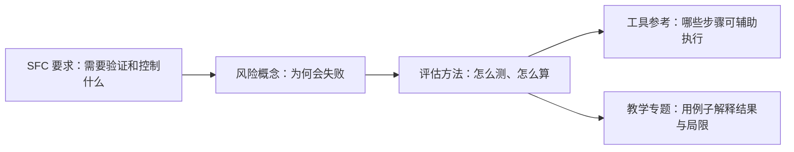

# SFC AI 风险管理知识库

**从香港证监会（SFC）的生成式 AI 语言模型监管要求出发，帮助风险管理人员理解相关风险、学习验证方法，并选择辅助评估的工具。**

SFC 在 2024 年 11 月发布 [24EC55《Use of generative AI language models》](https://apps.sfc.hk/edistributionWeb/api/circular/list-content/circular/intermediaries/supervision/doc?lang=EN&refNo=24EC55)，对持牌法团在受规管活动中使用 AI 语言模型提出风险管理要求，涵盖高管责任、模型风险、网络与数据风险、第三方风险四项核心原则。措施应与具体用例的风险及影响相称；对客投资建议、意见或研究一般属于高风险用途，需要额外措施（第6–8段，售后服务不包含在第8段的这一判断中）。

这些要求落实到技术层面，就会遇到具体问题：**怎样证明模型适合用途？如何验证带检索的系统？怎样检查幻觉、提示注入和资料泄漏？模型或数据改变后，如何判断风险是否增加？** 本库围绕这些问题，连接监管条款、风险原理、评估步骤、演算例子和现有工具。

[在线阅读](https://krisjiang-matrix.github.io/sfc-ai-risk-management/) · [先读 SFC 要求](docs/regulatory/index.md) · [查看覆盖与缺口](docs/coverage.md) · [English](README.en.md)

## SFC 提出了什么要求，本库提供什么

下表概括 24EC55 的主要要求，并说明对应内容的深度。具体适用条件与例外见[条款导读](docs/regulatory/24EC55.md)和官方原文。

| SFC 要求与原文定位 | 为什么需要相关知识 | 本库提供什么，覆盖到哪 |
|---|---|---|
| **高管责任与全生命周期治理**：治理、人员胜任能力、用途适当性及委派责任（第9–12段）；开发与验证等职能在可行且与风险相称时分离（第13(a)段） | 风险控制涉及组织责任和模型使用背景，不能只看技术分数 | 提供原文导读、适用范围和技术背景；**不展开机构治理、职责分工或审批制度的实施** |
| **模型验证与持续监测**：采用前及重大变更时验证，测试完整输入输出链路，持续检讨并记录结果（第13(b)–(d)段） | 单看基础模型的基准分数，不能说明检索、过滤、提示和工具组成的系统适合具体用途 | 提供评估设计、金标准、事实核验、RAG 分层评估、回归和漂移方法；以教学演算为主，缺少真实生产验证 |
| **客户输出与高风险用途措施**：AI 身份和可能不准确的披露；高风险用途的事实性验证、人审、提示变化测试与持续监测（第17–19段） | 引用不保证正确，人审也可能漏错；同义提示可能产生不同结果 | 提供输出可靠性、提示变化测试和人审盲测；披露要求保留原文解释，未提供机构客户流程或实施验收 |
| **网络与数据风险控制**：入侵识别、适当时暂停、可行范围内定期对抗测试；非公开数据加密、训练数据质量及全生命周期机密性（第20–25段） | 恶意输入可能覆盖指令，敏感资料可能经训练、检索、输出或第三方服务泄漏 | 提供提示注入、隐私和 Agent 边界的解释及测试路径；**训练数据提取、反演、多模态攻击等仅部分覆盖**，不替代企业网络安全控制 |
| **第三方风险管理**：尽调和监测、黑盒适用性、责任界面、组件供应链及中断预案（第26–29段） | 使用外部模型、向量服务或评估工具，会增加资料泄漏、依赖集中及服务中断风险 | 提供依赖识别、集中度与恢复比较、工具数据流和局限；**不完整覆盖供应商尽调、合同法律分析或机构应变计划** |
| **重大业务或服务改变的通知**（第30段） | 采用 AI 的监管判断还涉及业务变化，不能由测试通过直接推导 | 提供原文定位与适用性说明；不提供机构通知程序 |

2026 年 6 月的 [26EC32 通函](https://apps.sfc.hk/edistributionWeb/api/circular/list-content/circular/intermediaries/supervision/doc?lang=EN&refNo=26EC32)进一步要求应对 AI 增强型网络攻击，涉及漏洞管理、权限、监测、供应链、响应与恢复；即使机构自己不使用 AI，也可能适用。本库重点补充与模型对抗、不可信输入及工具权限有关的知识，**没有全面展开该通函的网络安全控制与组织实施**。

**因此，本库覆盖了上述要求涉及的主要技术学习主题，但尚未完整覆盖 SFC 全部要求的实施，也没有证明机构满足要求。** 现有[覆盖矩阵](docs/coverage.md)衡量的是选定知识主题的内容深度，不是逐条监管要求的完成率；其中“完整”不代表监管要求已全面落实。

## 为什么分成概念、方法、工具和教学专题

监管要求明确需要达到的目标；理解风险机制，才能选对测试方法；方法明确输入、判据和结果解释，工具才能帮助执行；教学专题则把这些环节放进一个可复核的例子。比如，“端到端验证”对应系统组件与 RAG 的知识，进而对应检索、生成及完整链路的评估，而不是安装一个工具就算完成验证。



这些主题是本库为解释监管要求组织的学习框架，**不是 SFC 指定的风险分类、方法清单或工具采购清单**。

## 知识库里有什么

按主题找内容。每一行把风险解释、评估做法和相关工具放在一起；点击即可阅读。

| 主题 | 讲什么 | 怎样检查或评估 | 相关工具与资料 |
|---|---|---|---|
| [AI 系统构成](docs/concepts/system-components.md) | 模型、提示、检索、记忆和工具分别在哪个环节产生风险 | [评估设计：确定对象、测试集与判据](docs/methods/evaluation-design.md) | [MLflow](docs/tools/mlflow.md) |
| [幻觉与输出可靠性](docs/concepts/output-reliability.md) | 答案为什么会编造事实、引用为什么可能不支持结论 | [事实与引用核验](docs/methods/factuality-and-citations.md)、[提示变化测试](docs/methods/prompt-variation.md) | [Promptfoo](docs/tools/promptfoo.md) |
| [评估基础](docs/concepts/evaluation-foundations.md) | 测试分数、样本与误差怎样影响结论 | [金标准标注](docs/methods/gold-standard-design.md)、[分层抽样](docs/methods/stratified-sampling.md)、[模型裁判校准](docs/methods/judge-calibration.md) | [Promptfoo](docs/tools/promptfoo.md)、[MLflow](docs/tools/mlflow.md) |
| [RAG：检索增强生成](docs/concepts/rag.md) | 找到资料后为何仍会答错，检索失败和生成失败有什么区别 | [检索评估](docs/methods/rag-retrieval-evaluation.md)、[生成评估](docs/methods/rag-generation-evaluation.md)、[分层诊断](docs/methods/rag-design-diagnostics.md) | [Ragas](docs/tools/ragas.md)、[Azure 评估器](docs/tools/azure-rag-evaluators.md) |
| [提示注入与对抗攻击](docs/concepts/robustness-and-security.md) | 恶意输入如何改变回答或绕过防护 | [对抗测试：同时检查漏拦与误拒](docs/methods/adversarial-testing.md) | [garak](docs/tools/garak.md)、[PyRIT](docs/tools/pyrit.md)、[NeMo Guardrails](docs/tools/nemo-guardrails.md) |
| [数据与隐私](docs/concepts/data-and-privacy.md) | 敏感信息如何经输入、检索、输出和日志泄漏 | [隐私测试与敏感信息检测](docs/methods/privacy-testing.md) | [Presidio](docs/tools/presidio.md)、[Purview](docs/tools/purview.md) |
| [公平性与解释](docs/concepts/fairness-and-explanation.md) | 群组差异、偏差和解释分别说明什么 | [分组指标与解释对照](docs/methods/fairness-and-explanation.md) | [Fairlearn](docs/tools/fairlearn.md) |
| [Agent 风险](docs/concepts/agent-risk.md) | AI 调用工具、修改记录时为何可能越权 | [执行边界测试：区分请求越权与实际执行](docs/methods/agent-execution-boundary-test.md) | [PyRIT](docs/tools/pyrit.md)、[Promptfoo](docs/tools/promptfoo.md) |
| [监测与漂移](docs/concepts/monitoring-and-drift.md) | 数据分布变化与性能下降有什么区别 | [漂移检测](docs/methods/drift-detection.md)、[变更回归](docs/methods/change-regression.md)、[监测数据质量](docs/methods/kri-data-quality-and-backtesting.md) | [Evidently](docs/tools/evidently.md)、[Phoenix](docs/tools/phoenix.md)、[MLflow](docs/tools/mlflow.md) |
| [第三方与韧性](docs/concepts/third-party-and-resilience.md) | 供应商依赖、软件依赖与故障恢复带来哪些风险 | [集中度与恢复效果比较](docs/methods/concentration-and-recovery.md) | [Syft](docs/tools/syft.md)、[Dependency-Track](docs/tools/dependency-track.md) |
| [人与 AI 交互](docs/concepts/human-ai-interaction.md) | 自动化偏见是什么，人工复核为何也会漏错 | [人审盲测：衡量发现错误的能力](docs/methods/human-review-challenge.md) | [表格与人工计算](docs/tools/existing-exports-and-spreadsheets.md) |

完整目录：[风险概念](docs/concepts/index.md) · [评估方法](docs/methods/index.md) · [工具与框架](docs/tools/index.md) · [术语表](docs/glossary.md)

## 先读一个完整例子

专题把问题、系统路径、合成测试结果和结论放在同一篇里，可以先看例子，再回查相关概念与方法。

| 教学专题 | 读完能理解什么 |
|---|---|
| [AI 找到资料，为何仍会答错？](docs/topics/rag.md) | 区分漏检资料、使用旧版本、引用不支持答案和权限泄漏 |
| [提示注入：防护拦住了攻击，正常任务还能完成吗？](docs/topics/prompt-injection.md) | 分别判断攻击成功、漏拦、误拒和正常任务表现 |
| [Agent 权限：模型提出越权请求，是否等于系统已越权？](docs/topics/agent-permissions.md) | 分开检查模型请求、权限控制和最终执行状态 |
| [模型裁判：自动评分能相信多少？](docs/topics/model-judge.md) | 用人工标注校准评分，检查漏判与误判 |

监管原文、参考方法和自编教学例子分别标识。教学数字不是监管阈值，文档核对不等于工具实测；各主题尚缺哪些实验或资料，见[覆盖说明](docs/coverage.md)。

## 如何开始

直接点击上面的主题或专题即可阅读。需要带搜索、侧栏导航和代码复制的本地网站时，在项目根目录运行：

Python 3.11–3.13；本地已验证 macOS ARM64，CI 配置使用 Ubuntu/Python 3.11 与 3.12。无需模型、GPU 或 API 凭据。先创建虚拟环境，安装锁定版本：

```bash
python3 -m venv .venv
source .venv/bin/activate
python -m pip install --require-hashes -r requirements-docs.lock
python -m mkdocs serve
```

Windows 使用 `py -3 -m venv .venv`，再运行 `.venv\Scripts\Activate.ps1` 激活。依赖范围记录在 `requirements-docs.txt`；锁文件固定直接与传递依赖及下载哈希，升级时须重新生成锁文件、构建与审计。

可选预览图：`python -m pip install --require-hashes -r requirements-preview.lock`，再运行 `python scripts/make_social_preview.py`。可用 `--font /path/to/font.ttf` 指定本机中文字体；缺少字体时明确报错，不下载或分发字体。

浏览器打开 `http://127.0.0.1:8000/`。正文以中文为主，英文概览见 [English README](README.en.md)。

## 参与完善

从[覆盖缺口](docs/coverage.md)选一个问题，补充解释、修正演算、核实来源或改进图解；按[贡献指南](CONTRIBUTING.md)完成检查并提交改动。

内容采用 [CC BY 4.0](LICENSE)，代码采用 [MIT](LICENSE-code)。本库为独立教学资料，监管要求以 SFC 官方文本为准。
