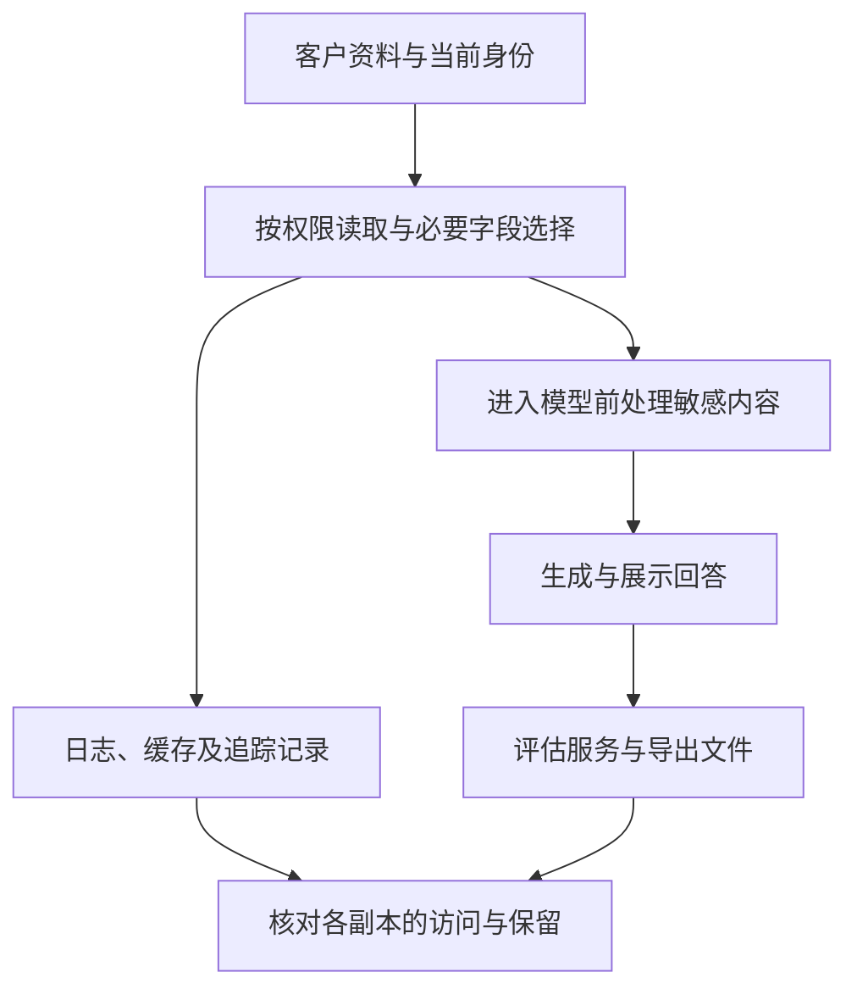

# 敏感数据怎样进入和离开 AI 系统

回答没有出现客户姓名，不代表敏感数据没有离开系统。原始问题可能已传给模型，检索片段可能已写入日志，评估服务也可能收到完整上下文。**隐私检查应从数据实际经过的接收方和副本出发，再判断识别、脱敏与访问控制是否覆盖这些路径。**

SFC 关联出处为 [24EC55 附录第 14–17 段](https://apps.sfc.hk/edistributionWeb/api/circular/openAppendix?lang=EN&refNo=24EC55&appendix=0)。以下分析属于技术解释与参考方法，并非监管指定程序、工具或阈值。

技术解释 · 本文更新：2026-10-11 · 所列来源查阅：2026-10-05 · 案例为合成教学材料，未执行模型或工具测试。

## 一次问答为什么会形成多个数据副本

假设内部助手帮助员工总结客户沟通记录。输入包含姓名、账户标识与产品偏好，系统还检索历史资料。为了排查错误，应用保存模型输入；为了自动评估，又把问题和回答交给另一项服务。即使主模型在本地运行，辅助处理仍可能形成新的存储位置或接收方。

<figure class="system-flow" markdown="1">

</figure>

图中的支路不是必然存在，却是需要核实的对象。应确认日志采集发生在脱敏前还是脱敏后、缓存保存什么、谁能访问导出，以及供应商设置与条款允许怎样使用资料，不能只询问主模型在哪里运行。

**个人可识别信息检测**把姓名、证件号等实体标记出来；**脱敏**对已识别内容进行删除、替换或转换。遗漏的实体不会因为开启转换就自动受到保护。删除姓名也未必使资料无法识别，职业、日期和地点的组合仍可能指向某个人。

## 内容泄漏与训练数据推断是不同问题

案例中，员工无权读取另一客户的记录，检索却把该记录交给模型。此时需要检查访问边界及泄漏路径。可在合成资料中植入不会与真实内容混淆的秘密标记，用不同身份检查回答、引用、日志与导出。只检查最终文本，会遗漏原始提示或追踪副本中的暴露。

**数据提取**关注是否能恢复具体内容；**成员推断**关注某条记录是否参加过训练；**模型反演**关注能否推断训练数据中的特征。向模型询问某客户是否在训练集里得到肯定回答，并不能证明成员身份：模型可能猜测或生成虚构内容。

成员推断需要已知成员与非成员对照、可用攻击接口和明确假设。两组记录若在长度或来源上原本不同，攻击可能只是识别这些差异。反演与提取也需要独立确认恢复内容是否真实，不能把看似合理的输出作为泄漏证据。

| 检查能力 | 所需前提 | 可形成的证据 | 主要限制 |
|---|---|---|---|
| 敏感实体识别 | 文本、语言与实体标注 | 已定义实体的命中与遗漏 | 未知格式、上下文组合可能漏检 |
| 越权泄漏测试 | 身份、权限与合成秘密 | 已测试路径是否传出未授权内容 | 日志和第三方副本须另行覆盖 |
| 成员推断 | 已知成员、非成员与攻击接口 | 区分训练成员的能力 | 分布差异可能造成伪信号 |
| 反演与提取 | 攻击目标及参考资料 | 恢复内容或推断特征的情况 | 接口限制与真实性确认影响结论 |

## 脱敏质量与数据路径分别核验

一组合成标注含 30 个敏感实体，检测命中 24 个，实体召回率为 24/30＝80%；另有 70 个普通实体，其中 7 个误报。这只说明该样本中已定义实体的识别表现，不能表述为“80% 隐私安全”。它没有检验未授权检索，也没有判断模型是否记住训练内容。

遗漏会使敏感内容继续进入下游，误报则可能破坏任务信息。例如删除所有产品编号，摘要可能无法区分产品；保留账户标识，又可能泄漏身份。处理策略需要与任务必要性结合，对照处理前后内容与输出。令牌化用代号替换真实标识时，映射表本身仍需保护。

核验应从各接收方和副本开始，再比较处理前后字段，最后用不同身份及合成秘密检查边界。处理若发生在发送之后，不能保护此前已传出的资料。详细步骤见 [隐私测试方法](../methods/privacy-testing.md)，检索与工具路径见 [提示注入专题](../topics/prompt-injection.md)。

## 辅助工具的能力与适用范围

敏感实体识别与数据管理是不同层次的能力。前者定位和转换文本，后者帮助理解资料类别及治理路径；两者都不能自行证明接收方遵守保留或训练限制。

| 能力类别 | 工具定位与用途 | 使用限制 |
|---|---|---|
| 文本识别与转换 | [Presidio](../tools/presidio.md) 提供本地敏感实体识别与转换路径 | 范围依赖语言、实体配置和格式；本地检测不代表全链路本地 |
| 数据管理 | [Purview](../tools/purview.md) 提供可选商业数据管理能力 | 需核对具体接入范围，不能替代模型接口和泄漏测试 |

工具不是 SFC 指定产品。未检测到泄漏，只能说明已覆盖路径和样本中的观察结果；供应商保存情况、未知副本及训练数据风险仍需相应证据。
