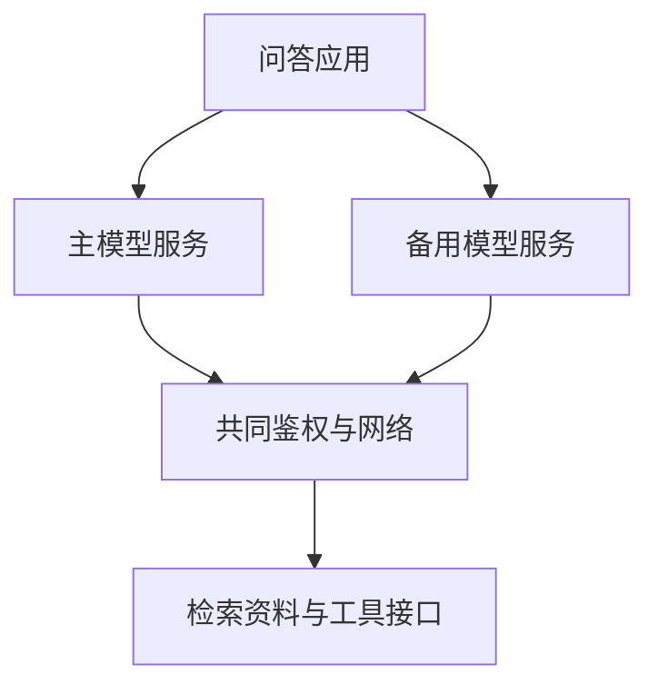

# 供应商和依赖怎样影响 AI 韧性

两个模型品牌不一定代表两条独立服务路径。它们可能共用云、网络、检索库或核验身份及访问权限的鉴权服务，备用模型也可能无法完成原来的任务。**AI 韧性需要观察中断后仍可提供哪些功能、质量是否保持，以及恢复后外部状态是否正确。**

SFC 关联出处为 [24EC55 通函第 4(c) 段](https://apps.sfc.hk/edistributionWeb/api/circular/openFile?lang=EN&refNo=24EC55)及 [附录第 16 段](https://apps.sfc.hk/edistributionWeb/api/circular/openAppendix?lang=EN&refNo=24EC55&appendix=0)。依赖图与恢复实验为技术解释和参考方法，不是监管规定的统一架构或阈值。

技术解释 · 本文更新：2026-10-11 · 所列来源查阅：2026-10-05 · 案例为合成教学材料，未执行模型或工具测试。

## 备用路径仍可能经过同一个故障点

假设产品问答系统使用主模型 A，故障时切换备用模型 B。两者品牌不同，却通过同一鉴权服务访问同一检索库。A 自身中断时，B 可能有效；鉴权服务中断时，两条路径都无法读取资料。供应商数量增加，没有自动消除共同依赖。

<figure class="system-flow" markdown="1">

</figure>

这是一张简化运行依赖图，实际系统可能在调用顺序上不同。重点是标出完成任务必需的服务与共同故障点。**集中度风险**关注多个路径依赖同一资源的程度；**韧性**关注故障条件下功能、质量与恢复能力，不能仅从品牌或合同数量推断。

软件包清单与运行依赖也不同。一个本地库是软件组成部分，远端模型、鉴权和日志存储则可能是运行时必需服务。只列出安装包，会遗漏供应商托管的在线服务（SaaS）、区域及网络依赖；只列供应商，也可能遗漏应用内部的单点。

## 回退可以恢复响应，却同时改变质量与权限

合成测试中，主模型中断影响 20 个请求，备用模型完成 18 个，其中 3 个回答错误。请求完成率为 18/20＝90%，正确完成率为 15/20＝75%。声称恢复率 90%，需要说明它统计的是有响应还是正确完成，不能用前者代替后者。

备用服务可能支持不同上下文长度、输出格式或工具接口。资料截断会遗漏条款，格式变化会使解析失败，权限过滤缺失则可能扩大访问范围。切换成功只说明进入了另一条路径，仍须核验任务条件、引用、授权和真实状态。

检索不可用时，系统若改为凭模型常识回答具体产品条款，可能使响应看似连续却失去依据。合理降级可以是保留公开常识解释，同时对无法核实的具体问题说明不足；可接受功能应按应用用途事先定义。

| 依赖对象 | 可能的故障影响 | 恢复核验重点 |
|---|---|---|
| 模型服务 | 超时或输出行为改变 | 备用路径的任务质量、格式与边界 |
| 检索与权限服务 | 资料缺失或无法授权 | 缺证据时的行为及未授权资料排除 |
| 工具与网络 | 回执丢失、重复提交 | 重试与外部最终状态 |
| 日志与观测 | 诊断记录缺失 | 业务是否受影响，证据能否恢复 |
| 第三方处理 | 输入被传输或保留 | 实际设置、条款及接收范围 |

## 中断、恢复与数据处理需要不同证据

隔离测试可分别模拟模型、检索及网络中断，记录超时、重试、回退条件和恢复后状态。工具操作成功但回执丢失时，重试可能重复产生副作用；因此不能只看可用性仪表，还要检查动作标识与最终记录。测试环境和故障方式应明确，模拟不能代表所有真实事故。

第三方数据风险也不能由恢复测试证明。需要核对实际传输字段、区域、保留设置及条款允许的用途。主模型不使用输入训练，并不意味着回退模型或观测服务具有相同条件。配置、合同与实际数据路径应分别有依据，不能从供应商名称推定。

完整测试见 [集中度与恢复测试](../methods/concentration-and-recovery.md)，记录与状态复核见 [证据复核方法](../methods/read-only-evidence-review.md)。恢复结论应标明请求分母、正确性判据、故障范围和降级功能。

## 辅助工具的能力与适用范围

**软件物料清单（SBOM）**描述软件组成，便于追踪依赖；运行依赖图描述完成任务所需的服务。两类信息互补，但清单不能覆盖全部 SaaS 条款和运行状态。

| 能力类别 | 工具定位与用途 | 使用限制 |
|---|---|---|
| 软件组成识别 | [Syft](../tools/syft.md) 可生成软件组成清单 | 不能独立识别所有远端运行依赖和数据处理 |
| 软件依赖分析 | [Dependency-Track](../tools/dependency-track.md) 可支持软件依赖路径分析 | 需结合实际部署、合同及故障实验解释 |

工具不是 SFC 指定产品。存在备用服务或软件清单，都不能独立证明业务连续；结论只覆盖已核验的依赖、故障条件和版本。
