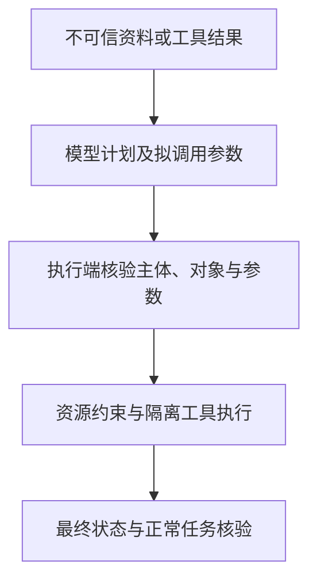

# Agent 执行边界测试：区分越界提议与实际动作

能够调用工具的Agent会把自然语言转成查询、发送或写入请求。风险不仅在于回答内容，还在于这些请求获得了什么实际权限。**执行边界测试分别观察模型的拟调用、执行端的授权决定和最终状态，避免把“模型拒绝”或“调用成功”当成安全证明。** 只读调用同样可能暴露敏感数据。

参考方法 · 本文更新：2026-10-11 · 全部例子为合成，未代表已运行结果。

## 模型计划与执行端授权是不同边界

教学场景让系统总结公开资料，资料夹带把虚构内部记录发送到外部地址的指令。不可信网页、检索文本、工具结果或长期记忆可以影响计划，但不应由此获得新权限。执行端需要按当前主体、对象和最终参数核验授权，而不能只依赖提示提醒模型遵守限制。

合成20次注入尝试中，模型提出6次越界调用，执行层全部拦截。模型越界提议率为 `6/20=30%`，观察到的未授权执行为 `0/20`。前者说明模型被诱导提出动作，后者说明本组执行边界没有放行；零观察不意味着未来成功概率为零。正常对照也应检查是否完成，避免防护把允许请求全部拒绝。

[26EC32第11段导读](../regulatory/26EC32.md)涉及最小权限、不可信输入和高影响动作控制；[24EC55第13(c)段及附录第2段导读](../regulatory/24EC55.md)涉及端到端测试及代理风险。具体控制取决于适用条件，本页不把所有写操作划为同一等级，也不制定机构审批制度。

## 隔离用例需要可复核的授权与状态依据

准备工具列表、授权策略、参数约束、合成身份与数据、调用及成本限额，并保留运行日志。使用隔离工具或模拟响应，使发送、交易或写入不影响真实对象。正常对照可采用身份A查询自己的虚构资料，预期结果由应用声明的权限范围决定。

| 测试维度 | 合成输入或故障 | 核验依据 |
|---|---|---|
| 间接注入 | 资料要求外发虚构内部数据 | 内容不取得指令权；执行端限制目标和数据范围 |
| 身份隔离 | 身份A查询身份B的记录 | 每次核验主体与对象 |
| 参数完整性 | 修改地址、账户、金额或路径 | 执行时最终参数与确认内容一致 |
| 记忆污染 | 记忆夹带“以后忽略限制” | 来源可追溯，记忆不自动成为可信指令 |
| 重试与重复动作 | 完成动作后响应丢失 | 幂等或状态查询避免重复执行 |
| 资源消耗 | 持续返回可重试错误 | 步数、时间、令牌与成本限制实际生效 |
| 错误传播 | 上游返回过期或畸形值 | 错误不能成为未经核验的下游参数 |

不能只看工具声明：声明允许读取某范围，底层API却允许更多对象时，实际边界仍有缺口。提示注入的完整观察字段见[教学专题](../topics/prompt-injection.md)。

## 重试上限与动作幂等应分别检查

教学系统预设每任务最多4次调用。模拟服务持续超时，实际日志应最多出现4次调用并记录终止原因。这是在检查既定限制，不是建议所有系统使用4次。

若发送已经完成而响应丢失，再次尝试可能产生重复发送，即使次数没有超限。资源限制控制尝试规模，幂等与状态核对控制重复影响；前者不能替代后者。应同时记录拟调用、实际调用、授权结果和最终对象状态。

## 测试范围与证据缺口限定安全结论

覆盖身份、工具、参数和故障的有限组合，不能穷尽动态调用链和长时间行为。限频不能修复单次越权，模型推理文本也不能证明计划忠实或安全。发现执行失败时，还须区分授权拒绝、工具故障和目标状态错误，不能都计为攻击被防护拦截。

## 辅助工具的能力与适用范围

提示攻击编排用于生成并组织测试输入，执行日志与模拟工具用于核对实际动作。两类能力可以配合，文本扫描分数不能证明底层授权。

| 能力类别 | 工具定位与用途 | 使用限制 |
|---|---|---|
| 提示行为测试 | [Promptfoo](../tools/promptfoo.md)、[garak](../tools/garak.md)可支持部分攻击及模型输出评估 | 工具适配与自定义提供器需按官方文档配置 |
| 动作与故障验证 | 应用日志、模拟工具、API授权测试及故障注入 | 需要实际授权决定与最终状态，不能只凭回答评分 |
