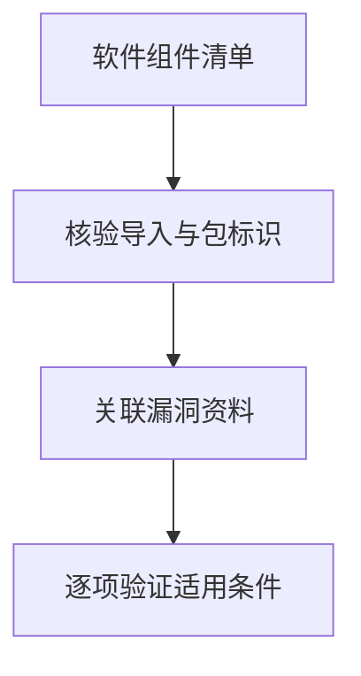

# Dependency-Track：SBOM 怎样转成依赖风险线索

应用使用的第三方软件包可能存在已知漏洞，但仅有依赖名称，还不能判断具体部署是否受影响。**Dependency-Track 将软件物料清单与漏洞资料关联，提供需要进一步复核的组件匹配结果。** 分析的起点是组件可见性，终点仍需结合实际版本、运行条件和调用路径判断影响。

核实日期：2026-10-05 · 页面状态：[可选工具/框架] · 维护周期：重要产品及接口变化时复核

## 从组件清单形成漏洞候选匹配

[技术解释] Dependency-Track 使用 CycloneDX 格式的软件物料清单做组件分析，关联漏洞及许可信息，输出匹配结果和分析状态。它适合 AI 应用的软件供应链，不扫描提示、模型行为或训练数据。[官方文档](https://docs.dependencytrack.org/)

软件物料清单（SBOM）记录已识别组件的名称、版本、标识及依赖关系；CycloneDX 是一种交换格式。系统据这些元数据匹配外部漏洞信息，因此输入缺少版本或包标识错误，都会改变候选结果。扫描出的组件数量也应与原始清单核对，防止把未成功导入的缺项当作没有风险。

候选匹配意味着资料库认为某个组件可能满足受影响条件，不等于攻击在当前部署中可行。后续要查受影响版本、功能是否启用、相关函数是否可达，以及应用权限和输入条件。反过来，没有候选匹配也不保证安全，可能只是资料源尚未覆盖或组件尚未正确识别。

典型数据流：[Syft](syft.md) 等生成 SBOM → Dependency-Track → 漏洞和组件数据源 → 匹配结果。部署可自托管，但数据库同步会连接外部源，内部组件名与软件结构也属于需控制的元数据。

<figure class="system-flow" markdown="1">

<figcaption>匹配结果是分析起点，不是当前部署中可利用漏洞的确认结果。</figcaption>

</figure>

## 先核验导入完整性与组件标识

[参考方法] 按官方部署说明固定 API server 和 frontend 的兼容版本；它们是分开的组件，不能把 API 端口当完整 Web UI。先创建合成项目，按实际项目 UUID 导入 SBOM，再核对导入完成状态、组件数和标识符是否一致。本页不提供虚构 UUID 的上传命令，也未运行 Docker 或 API。

核心 [Apache-2.0 许可](https://github.com/DependencyTrack/dependency-track)，最新发行版本未在本页重新核实。运行依赖、外部数据源与商业服务另行考虑。

## 候选匹配需要逐项验证适用条件

[教学示例] 假设导入一份包含 50 个合成组件的 SBOM，处理完成后在结果中看到 4 条候选匹配。逐条复核得到：

| 候选项 | 核对结果 | 当前结论 |
|---|---|---|
| A | 组件实际版本不在受影响范围 | 本例不适用，保留版本证据 |
| B | 受影响函数在本示例部署中不可达 | 不能仅凭匹配认定可利用；可达性依据须单独验证 |
| C | 影响范围尚未核清 | 待验证 |
| D | 影响范围尚未核清 | 待验证 |

操作时先使用隔离的合成项目和 SBOM，按所部署版本的官方说明导入；确认处理完成，并抽查已知组件的名称和版本，再查看候选项。表中 4 条及其状态都是教学设定，不是扫描结果。不能称“应用有四个可利用漏洞”，也不能因两条目前不适用/不可达就断言剩余风险低。

进一步查数据源时间、包标识、影响版本、运行条件、可达性及版本差异；通用严重性分数不等于本应用影响。没有匹配可能是数据库未覆盖、标识错误或同步失败。

## 软件依赖分析与模型风险的边界

SBOM 不证明完整依赖覆盖，也不能独立识别权重投毒、检索文档投毒或模型供应商数据使用。已有漏洞库查询与人工组件分析可起步；模型与黑盒服务知识见 [第三方与韧性](../concepts/third-party-and-resilience.md)。
