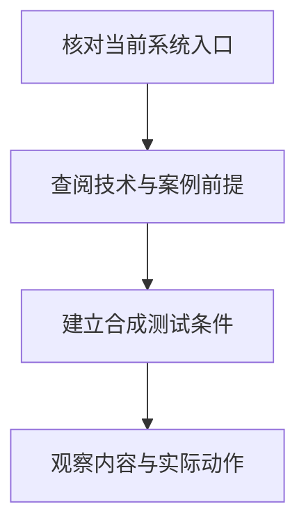

# MITRE ATLAS：怎样从攻击路径学习 AI 风险

同一种攻击手段，只有在目标具备相应入口和权限时才可能奏效。理解 AI 安全风险需要还原攻击者能够接触什么、改变什么，以及这些改变如何造成影响。**MITRE ATLAS 通过战术、技术和案例组织攻击路径知识，帮助建立这些前提。** 它提供场景来源，实际漏洞仍需在当前系统中验证。

核实日期：2026-10-05 · 页面状态：[可选工具/框架] — 威胁知识资料 · 维护周期：官方内容、名称及数据格式更新时复核

## 战术、技术与案例提供不同层次的证据

[技术解释] MITRE ATLAS 是 AI 系统攻击战术、技术和案例的公开知识库。战术描述攻击目的，技术描述实现手段，案例连接具体事件与技术。它帮助理解暴露面和攻击路径，与自动测试软件的功能不同。[官方入口](https://atlas.mitre.org/) · [官方数据仓库](https://github.com/mitre-atlas/atlas-data)

ATLAS 与 ATT&CK 有关联，但不能用一个静态的“十二个战术”列表表示所有当前内容。战术名称、关系和技术覆盖随版本变化；具体对应关系应查官方数据，而非仅根据技术名称推断。

## 内容版本与数据格式应分别记录

本次核实的 [官方 manifest](https://github.com/mitre-atlas/atlas-data/blob/main/dist/manifest.yaml) 列出内容版本 **2026.09**，发布日期 **2026-09-15**，对应格式版本 **6.0.0**。内容版本与数据格式版本分别记录；旧资料的 5.6.0 不能直接当成当前内容版本。

以下是 [2026.09 数据](https://github.com/mitre-atlas/atlas-data/blob/main/dist/v6/ATLAS-2026.09.yaml) 的部分战术入口及本库阅读提示，**不是完整矩阵或正式逐条映射**：

| 战术入口 | 帮助读者提出的问题 | 关联知识 |
|---|---|---|
| AI Model Access | 攻击者能够查询接口、接触模型文件，还是只间接影响输入？ | [系统构成](../concepts/system-components.md) |
| AI Attack Adaptation | 通用攻击怎样针对当前目标改变提示、数据或动作？ | [稳健性与安全](../concepts/robustness-and-security.md) |
| Reconnaissance | 哪些公开信息帮助识别模型、接口或依赖？ | [第三方与韧性](../concepts/third-party-and-resilience.md) |
| Collection、Exfiltration | 收集到的信息能否通过回答或工具调用离开系统？ | [数据与隐私](../concepts/data-and-privacy.md) |
| Impact | 攻击怎样改变完整性、可用性或结果可信度？ | [输出可靠性](../concepts/output-reliability.md) |

当前数据的 `AML.TA0001` 名称为 **AI Attack Adaptation**；旧版本可见 AI Attack Staging。学习时应同时保存版本、技术标识及对应关系，避免将新名称与旧归属拼接。

## 将攻击前提转成可观察的测试条件

从资料中选择技术之前，先画出当前系统的输入、资料和动作路径。攻击者若只能修改公开文档，其条件与直接访问模型文件明显不同；模型能够生成工具请求，也与工具实际拥有外发权限不同。把案例中的前提逐项对照当前系统，可以避免仅凭技术名称认定适用。

随后确定测试输入、观察位置和成功条件。外泄场景至少要区分秘密被读取、模型产生外发意图、工具接受参数，以及数据确实离开约定边界。分阶段保留证据，才能说明攻击停在哪一环节；某个阶段未发生，也不能推出其他未测路径不存在。

[参考方法] 从系统路径入手：输入由谁控制、文档如何检索、模型能调用什么工具、秘密在哪里保存。查看 ATLAS 技术的适用条件及案例，再构造能验证这些条件的合成测试。攻击类别不能直接证明某个工具已有对应探针。

[教学示例] 合成 RAG 文档插入指令，要求模型把秘密标记送至外部地址。测试分别观察检索内容是否被误当高优先级指令、是否产生工具调用、工具参数是否被允许、实际输出是否泄露。只发现模型文本提到地址，不等于外泄动作已经成功。

[garak](garak.md)、[Promptfoo](promptfoo.md)、[PyRIT](pyrit.md) 可执行部分对抗场景；[Agent 边界测试](../methods/agent-execution-boundary-test.md) 观察工具动作。软件组件分析可用 [Syft](syft.md)，但 SBOM 不能证明模型权重或检索内容没有被投毒。

<figure class="system-flow" markdown="1">

<figcaption>分类知识用于提出问题，系统证据用于验证问题，两者承担不同角色。</figcaption>

</figure>

## 分类知识与系统验证结果的边界

ATLAS 分类提供问题来源，测试提供特定系统的观察结果。分类存在不代表漏洞存在，未被分类的新攻击也可能出现；即使全部适用条目都有测试，也不能证明系统安全或满足 SFC 要求。案例中的前提与本地系统不同，结论需要重新验证。

ATLAS 的数据与图表使用遵循其 [官方许可](https://github.com/mitre-atlas/atlas-data/blob/main/LICENSE)，不要因公开可读就假设所有内容均为 MIT 或 Apache 许可。辅助资料：[OWASP GenAI](owasp-genai.md)、[对抗测试方法](../methods/adversarial-testing.md)。

来源登记：source_id: `MITRE-ATLAS-DATA`。
