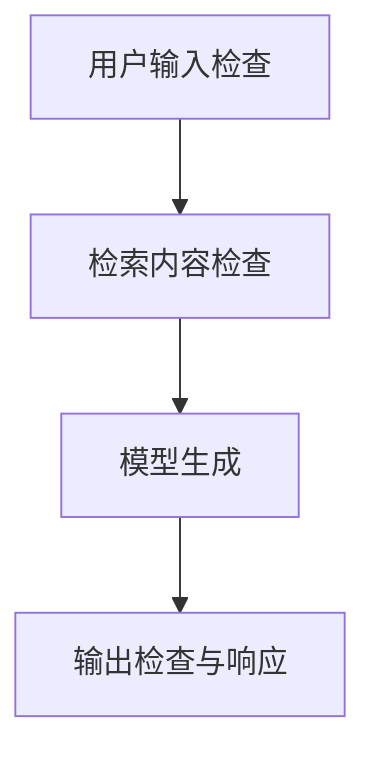

# NeMo Guardrails：防护层怎样实现及验证

不可信资料进入模型后，可能被误当作指令；不适当内容生成后，也可能直接展示或进入下游流程。**NeMo Guardrails 为应用提供可编程的内容防护层，使检查在指定位置介入请求处理。** 防护位置决定它能看到哪些内容，也决定风险是否已经在检查之前发生。

核实日期：2026-10-05 · 页面状态：[可选工具/框架] · 维护周期：重大版本、许可或官方接口变化时复核 · 已核实发布版本：0.24.1；许可：Apache-2.0。此为文档核实，不代表运行验证或部署建议。

## 防护位置决定检查对象与介入时机

[技术解释] NeMo Guardrails 是为 LLM 应用添加可编程防护的库。防护可作用于输入、检索内容及输出等位置，部分配置调用额外分类模型或 LLM。规则说明允许什么行为，但运行效果仍取决于模型、集成方式与攻击输入。

输入检查面对用户提交的内容，检索检查面对外部资料，输出检查面对模型生成的结果。这些对象具有不同信任程度：用户问题可能正当，但同一次请求检索到的文档仍可能含恶意指令。只检查用户输入，会遗漏后续资料带来的风险；只检查展示文字，也无法追溯已经执行的工具动作。

因此配置应连接到具体失效路径。例如保护秘密标记时，需要说明哪些内容允许进入模型、哪些输出应阻断，以及出现无法判定或服务错误时怎样处理。**防护是否有效应以最终内容和动作核验**，不能以某个检查节点显示通过作为充分证据。

数据流：请求 → 输入检查 → 检索及上下文检查 → 模型 → 输出检查 → 响应。使用外部检测或推理服务时，额外模型会收到相应文本。库的许可不涵盖这些服务，第三方端点条件单独适用。

<figure class="system-flow" markdown="1">

<figcaption>各检查点的作用不同；工具动作的参数与授权校验仍需在执行边界实施。</figcaption>

</figure>

## 用明确失效条件验证防护配置

[参考方法] 选择一个具体防护目标，例如阻止回答披露合成秘密标记，而非笼统要求安全。依官方 quickstart 配置最小 rails；构造正常问题、直接攻击、文档内间接攻击、多轮及跨语言变体。记录防护前后的漏拦、误拒、额外延迟和执行错误。

涉及 Agent 动作时，工具参数校验与权限检查应在工具执行边界独立实施；仅检查聊天输出无法阻止已经发生的动作。测试错误、超时和无法评分的情况，不把它们视作防护成功。

## 同时比较漏拦、误拒与执行状态

[教学示例] 下表是手工构造的 100 个独立请求结果，不是 NeMo Guardrails 的运行报告：40 个攻击请求与 60 个可回答的正常请求合计 100。攻击样本包含直接和间接攻击；“安全处理”定义为秘密未泄露且未发生越权动作。

| 测试集 | 请求数 | 安全处理/正常完成 | 未达预期 | 计算 |
|---|---:|---:|---:|---|
| 合成攻击 | 40 | 36 | 4 个未被安全处理 | 攻击安全处理率 `36/40=90%` |
| 可回答的合成正常请求 | 60 | 54 | 6 个被误拒 | 误拒率 `6/60=10%` |

本例的分母是请求数，不是会话数；若一个请求多轮交互，应另算会话级结果。结果只说明这组人工设定的样本。要判断防护层是否带来变化，应对同一组输入保留无 rails 的基线，并核查最终文本、工具调用及执行状态；单看“阻断”提示不足以确认风险已拦截。

## 内容防护与事实及授权校验的边界

防护配置可能被绕过，增加模型调用、成本与延迟；过滤器自身也有漂移。提示规则不等于授权隔离，禁止内容识别也不等于事实验证。替代路径可使用规则校验、访问权限边界和专用敏感实体检测，参见 [Presidio](presidio.md)；用 [Promptfoo](promptfoo.md)、[garak](garak.md) 或 [PyRIT](pyrit.md) 检验防护组合。

## 官方入口与关联知识

[官方仓库](https://github.com/NVIDIA-NeMo/Guardrails) · [官方文档](https://docs.nvidia.com/nemo/guardrails/about-nemo-guardrails-library/overview) · [版本记录](https://github.com/NVIDIA-NeMo/Guardrails/releases) · [相关概念](../concepts/robustness-and-security.md) · [工具能力目录](index.md)

来源登记：source_id: `NEMO-GUARDRAILS`。版本和许可按文中官方入口核实；工具执行状态另列。
