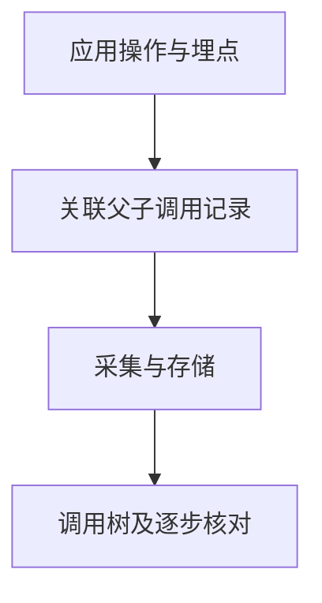

# Phoenix：怎样观察 LLM、检索和工具调用链

一次错误回答可能经过检索、模型和工具多个环节。只保存最终文字，难以判断正确资料是否被找到、是否实际送入模型，以及错误在哪一步出现。**Phoenix 通过关联同一请求的调用记录还原执行过程，为定位证据缺口和性能问题提供观察依据。** 记录的完整性与业务正确性需要分别验证。

核实日期：2026-10-05 · 页面状态：[可选工具/框架] · 维护周期：重大版本、许可或官方接口变化时复核 · 已核实发布版本：20.19.0；许可：ELv2（核心，源码可见；非无限制开放许可）。此为文档核实，不代表运行验证或部署建议。

## 用关联调用记录还原请求执行路径

[技术解释] Phoenix 支持语言模型应用的调用链追踪（tracing）、数据集与评估。输入是应用采集的调用记录及评估数据，输出是调用树与关联评估结果。

span 表示一次被记录的操作，例如一次检索或模型调用；父子关系把这些操作连成同一请求的调用树。它能说明某个阶段记录了什么输入和输出，以及操作的时间关系。实际资料是否可见，则取决于埋点是否采集了相应字段，不能从界面缺少记录直接推断应用没有执行。

例如调用树显示检索返回了正确年份的文档，只能证明该阶段的返回记录包含它。接下来仍需检查上下文组装后的实际输入，排除截断、排序或提示覆盖。如果模型收到正确证据后仍回答错误，才有依据进一步检查生成与展示环节。

应用中的埋点先采集操作记录，再经采集端（collector）或 Phoenix 服务送入数据库，形成调用树和关联评估。可自行部署，也可使用托管服务。提示、上下文、工具参数和异常消息可能包含敏感数据；脱敏应发生在采集前，不能只隐藏界面字段。

<figure class="system-flow" markdown="1">

<figcaption>图示为观测记录路径；可见内容取决于埋点覆盖和采集字段。</figcaption>

</figure>

## 从单个合成请求核验采集覆盖

[参考方法] 从一个合成 RAG 请求开始，记录请求关联标识、检索文档标识、模型调用、工具结果、耗时和错误。检查父子 span 是否正确连接，避免重复记录或遗漏异步调用。把评估结果连接到同一请求，保留模型和提示版本。

## 调用耗时与证据路径需要分别解读

[教学示例] 顺序调用的请求耗时 2.8 秒：检索 0.4、模型 2.0、工具 0.3、其他 0.1 秒。先查看模型 span 可解释主要延迟。若工具和模型实际并行，不能将所有 span 耗时相加；token 成本也需区分重复调用、裁判调用和缓存。

耗时分析与内容核验使用同一调用链，却回答不同问题：耗时反映运行时间，内容记录帮助查证实际输入。Tracing 不能独立断言答案正确或所有安全边界生效。

## 观测记录的证据边界与许可条件

核心 [LICENSE](https://github.com/Arize-ai/phoenix/blob/main/LICENSE) 为 Elastic License 2.0，限制将实质功能作为第三方托管服务提供。不同子包可能采用不同许可，不能概括为全部 MIT 或 Apache。自行部署与商业云服务也有不同数据路径。许可分类据 2026-10-05 官方仓库核实。

替代路径是 [MLflow](mlflow.md) 的 tracing／实验记录，或符合任务需要的 OpenTelemetry 调用记录。任何观测软件都需验证采集覆盖和脱敏效果。

## 官方入口与关联知识

[官方仓库](https://github.com/Arize-ai/phoenix) · [官方文档](https://arize.com/docs/phoenix) · [版本记录](https://github.com/Arize-ai/phoenix/releases) · [相关概念](../concepts/system-components.md) · [工具能力目录](index.md)

来源登记：source_id: `PHOENIX`。版本和许可按文中官方入口核实；工具执行状态另列。
