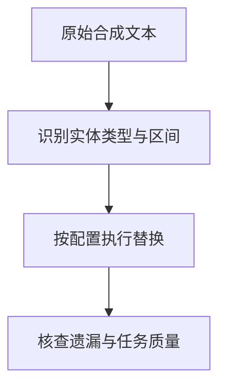

# Presidio：敏感实体识别和脱敏能做什么

客户姓名、号码和内部标识可能随着提示、检索片段或日志进入其他系统。保护这些内容需要先定位敏感区间，再验证替换后的数据是否仍能完成任务。**Presidio 将敏感实体识别与脱敏操作分开，使识别效果和处理效果可以分别检查。** 减少可见标识并不自动消除重新识别的可能。

核实日期：2026-10-05 · 页面状态：[可选工具/框架] · 维护周期：重大版本、许可或官方接口变化时复核 · 已核实发布版本：2.2.364；许可：MIT。此为文档核实，不代表运行验证或部署建议。

## 实体识别与区间替换是两个独立环节

[技术解释] Presidio 的 Analyzer 将命名实体识别、模式、校验和与上下文识别结合，输出实体类型、位置和置信分数；Anonymizer 对命中区间执行替换、掩码等操作。文本、图像与结构化数据有不同组件。项目已迁至 Data Privacy Stack，旧 Microsoft 地址可能跳转。

识别器返回位置与类型，脱敏器再依据配置处理相应区间。若第一步漏掉客户标识，第二步即使完全按照配置执行，原文仍会保留；若第一步误把产品编号当作个人信息，替换则可能破坏后续事实核对。因此应分别检查原始实体是否被找到、命中区间是否准确，以及处理后的文本是否仍满足任务需要。

例如合成客户编号采用机构自定义格式，默认实体类别未必覆盖该编号。需要先明确保护对象与语言范围，再建立对应的合成正例和易混淆负例。复查应包含独立人工核对，而不只是再次运行同一个识别器，否则同类漏检可能在两次检查中都不可见。

原始文本先经识别形成实体区间，再按操作配置生成处理后的文本。可本地运行 Python 或容器，但若配置外部识别服务、下载 NLP 模型或写日志，仍存在额外数据路径。

<figure class="system-flow" markdown="1">

<figcaption>识别遗漏会继续留在处理结果中，误检则可能损害原有信息。</figcaption>

</figure>

## 用语言与格式变体验证识别和脱敏

[参考方法] 先确定保护对象，例如姓名、证件、电话号码和客户标识符，再查对应语言的识别器。用合成正例、易混淆负例和变体构造人工真值；测试大小写、分隔符、中文、跨行和上下文。根据误检与漏检选择识别配置，不把默认阈值当通用风险界线。

随后验证替换是否破坏任务质量，并检查原文是否留在调用日志、异常信息、检索缓存或可还原映射中。实体检测只是减少泄露的一层，不能证明不可再识别。

## 识别精确率与召回率分别描述什么

[教学示例] 合成文本有 20 个敏感实体，识别器命中 18 个区间；人工判定其中 15 个正确。精确率=15/18≈83.3%，召回率=15/20=75%。另有三个普通片段被误删、五个敏感实体遗漏。不能用“脱敏后没有命中”证明没有敏感信息，尤其当复查仍使用同一个识别器。

## 实体覆盖与隐私攻击覆盖的区别

部分实体仅支持特定地区和语言，不能假设能识别香港证件号或所有中文姓名。英文识别器不能直接替代本地语言验证。[官方实体与语言表](https://presidio.dataprivacystack.org/supported_entities/) 是覆盖依据。PII 识别也不检测成员推断、模型反演或训练数据记忆；这些需采用相应攻击评估。替代路径是人工标注与抽样、任务特定规则；大型数据发现可参考 [Purview](purview.md)。

## 官方入口与关联知识

[官方仓库](https://github.com/data-privacy-stack/presidio) · [官方文档](https://presidio.dataprivacystack.org/) · [版本记录](https://github.com/data-privacy-stack/presidio/releases) · [相关概念](../concepts/data-and-privacy.md) · [工具能力目录](index.md)

来源登记：source_id: `PRESIDIO`。版本和许可按文中官方入口核实；工具执行状态另列。
