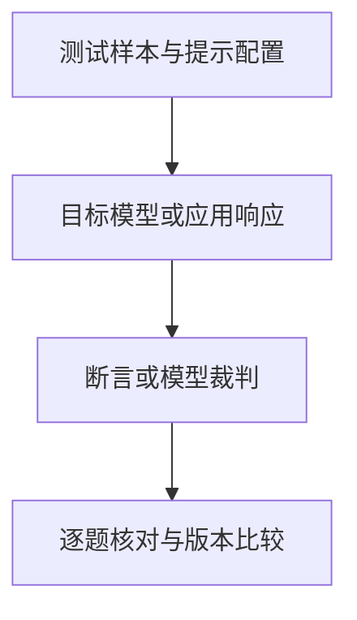

# Promptfoo：提示对比、回归和红队测试

修改提示后，一组回答的平均分可能提高，某些关键事实却同时退化。要判断变更是否有效，需要让不同配置回答同一组问题，并按相同判据保留逐题结果。**Promptfoo 将提示、目标接口、测试样本和断言组织成可重复的评估，也可组织红队场景。** 它负责执行和整理证据，任务边界与正确答案仍需由测试设计确定。

<div class="article-meta" markdown="1">

核实日期：2026-10-05 · 页面状态：[可选工具/框架] · 维护周期：官方版本与接口重要变化时复核

</div>

## 固定样本与判据后比较不同配置

[技术解释] Promptfoo 的开源核心支持提示、模型与应用评估，也提供红队插件和攻击策略，包括多轮等方法，不能概括为仅支持基础对抗测试。回归评估使用固定样本比较配置，红队评估则增加风险类别与攻击输入变化。自动评判不证明真实业务风险成立。[官方红队指南](https://www.promptfoo.dev/docs/red-team/) 和 [策略目录](https://www.promptfoo.dev/docs/red-team/strategies/)

这里的 provider 是连接被测模型或应用的接口适配方式；prompt 是交给目标的提示模板；test 提供具体输入与预期要求；assertion 是检查响应的判据。四者分别决定测谁、如何提问、使用哪些样本和依据什么判断。红队插件与攻击策略在此基础上增加风险场景和输入变化，不能替代业务成功条件的定义。

例如管理费回答需要同时核对比例、币种、有效日期和产品身份。只要求输出包含某个数字，会把包含数字但否定该费率的回答也算作通过。**评估配置的完整性决定结果能够支持什么结论**；执行更多样本并不能修补含糊的判据。

## 回归评估与脆弱性扫描的能力差异

<div class="tool-evidence-table" markdown="1">

| 维度 | Promptfoo | garak |
|---|---|---|
| 主要组织方式 | provider、测试、断言；红队插件和策略 | generator、probe、detector、harness |
| 可用能力 | 回归、输出对比、RAG 断言、系统红队测试 | LLM／应用弱点扫描，静态、动态与自适应探针 |
| 判断方式 | 确定性断言及模型裁判 | 探针对应检测器及模型检测 |
| 选择依据 | 目标接入、风险类别、会话和输出需求 | 目标接入、探针覆盖、检测器适用性 |

</div>

不能只凭工具名称判断覆盖深浅。固定目标和攻击预算后，比较原始案例及人工确认结果；两者的聚合分数不能直接横比。

## 测试配置如何形成响应与判定

输入为提示、变量、模型接口及断言，输出为逐题响应、通过状态、得分及错误。需要与发布版本匹配的 Node.js 环境及 provider 配置。数据流为本地测试配置 → 目标 provider → 断言／裁判 → 本地结果；模型裁判也可能调用外部服务。托管功能、红队生成服务和远端模型的数据路径要分别核实。

已核实版本 [0.123.1](https://github.com/promptfoo/promptfoo/releases)，开源核心 [MIT 许可](https://github.com/promptfoo/promptfoo/blob/0.123.1/LICENSE)；商业功能及供应商服务条款另计。

<figure class="system-flow" markdown="1">



<figcaption>执行错误与质量失败应分别记录；裁判也可能形成额外数据传输。</figcaption>

</figure>

## 用管理费问答建立最小评估配置

[教学示例] 下列配置说明现有工具用法，本次没有安装软件、调用模型或验证输出。使用合成信息，设置 provider 所需环境变量后保存为 `promptfooconfig.yaml`；模型名称仅为接口示例，运行时确认可用版本。

```yaml
prompts:
  - '只根据资料回答。资料：{{context}}。问题：{{question}}'
providers:
  - openai:gpt-4o-mini
tests:
  - vars:
      context: '合成产品A管理费率为1.5%，资料日期2026-09-01。'
      question: '管理费率是多少？'
    assert:
      - type: contains
        value: '1.5%'
```

```powershell
npx promptfoo@0.123.1 eval -c promptfooconfig.yaml
```

包含 `1.5%` 不等于答案准确，例如“不是 1.5%”也可通过 contains。补充人工核对或明确裁判规则，逐题检查否定、单位、日期及引用。红队测试需在独立配置说明应用目的、允许行为、目标接口及攻击预算，不能从上述质量断言推断安全覆盖。

## 通过断言与业务结果正确的区别

[参考方法] 区分失败断言与执行错误；逐题保留响应和判据。模型裁判需对照人工标注，尤其是金融事实、中文和否定表达。变更比较应保持测试集及裁判不变。没有命中攻击只能说明已测样本上的表现。

替代：[garak](garak.md)、[PyRIT](pyrit.md)、[Ragas](ragas.md)，或人工固定测试集。关联：[评估基础](../concepts/evaluation-foundations.md)、[安全风险](../concepts/robustness-and-security.md)、[生成评估](../methods/rag-generation-evaluation.md)。

来源登记：source_id: `PROMPTFOO`。版本和许可按文中官方入口核实；工具执行状态另列。
