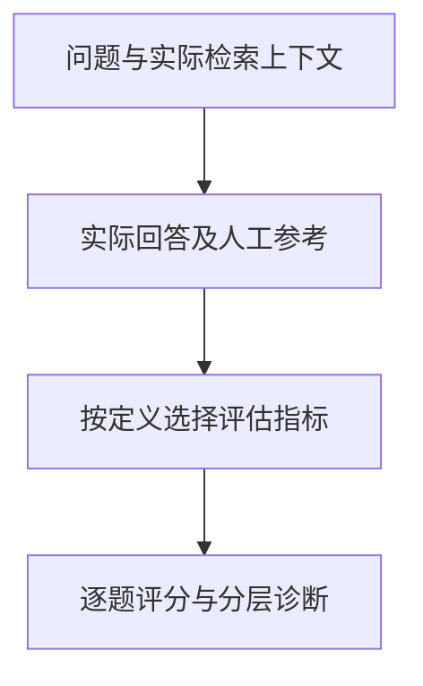

# Ragas：怎样拆分检索与生成质量

问答系统给出错误答案时，问题可能出在资料未被找回，也可能出在模型没有正确使用已有证据。总体正确率不能区分这两条路径。**Ragas 通过不同指标分别检查检索上下文与生成回答，为分层诊断提供逐题记录。** 指标的含义取决于所需字段和判定机制，不能将所有分数理解为事实准确率。

核实日期：2026-10-05 · 页面状态：[可选工具/框架] · 维护周期：重大版本、许可或官方接口变化时复核 · 已核实发布版本：0.4.3；许可：Apache-2.0。此为文档核实，不代表运行验证或部署建议。

## 检索覆盖与回答受证据支持的区别

[技术解释] Ragas 支持 LLM 应用评估、合成测试集及 RAG 指标。评估数据通常包括问题、检索上下文、回答；需要参考答案的指标还需人工确认的参考。Faithfulness 关注回答中的声明是否得到上下文支持，而不是上下文是否真实。Context recall 关注必要信息是否被检索到；不同指标所需字段和裁判机制不同，按版本文档选择。

问题与实际检索记录进入所选指标的计算或裁判过程，得到逐题得分后，再按失败类型或任务群组比较。采用远端 LLM 或 embedding 时，上下文和答案可能离开本地；安装包在本地并不意味着评估全程在本地。README 说明匿名使用统计可通过 `RAGAS_DO_NOT_TRACK=true` 关闭，模型供应商日志须另外考虑。

<figure class="system-flow" markdown="1">

<figcaption>图中是理解评估对象的简化过程，不表示所有指标使用相同字段或同一裁判。</figcaption>

</figure>

## 以人工确认的样本校准评估指标

测试数据应反映系统实际使用的证据，而不是事后补充一段理想资料。若把正确答案所在的全文作为上下文送给评估器，而应用运行时只收到部分片段，得到的分数描述的是另一条链路。需要把问题、实际检索片段、实际回答和参考判据关联到同一请求，再决定哪些指标能够计算。

对于资料未说明最低赎回额的问题，参考判据可以要求回答明确说明信息不足。这样才有机会区分合理拒答与无依据补全。指标用于缩小排查范围：检索覆盖不足应回查资料准备和检索过程，证据齐全而声明失真则应检查生成过程。

[参考方法] 从已标注的少量样本开始，选择一个检索指标和一个生成指标；保留文档版本、检索排名、原始回答和裁判版本。先人工复核裁判与人类分歧，再扩大测试集。Ragas 0.4 系列有 API 迁移，旧教程不能直接拼接到新接口。使用官方 quickstart 和该版本 migration guide，不将自动生成题目直接当金标准。

## 声明核对如何形成忠实度判断

[教学示例] 问题询问合成产品的管理费、投资地区、报告日期和最低赎回额。检索上下文写明“管理费 1.5%；主要投资亚太股票；报告日期 2025-06-30”，但没有提到最低赎回额。待核回答是：“管理费 1.5%，主要投资亚太股票；报告日期 2025-06-30；最低赎回额为 0。”

| 声明 | 上下文是否支持 |
|---|---|
| 管理费 1.5% | 是 |
| 主要投资亚太股票 | 是 |
| 报告日期 2025-06-30 | 是 |
| 最低赎回额为 0 | 否，资料未说明 |

人工按这四条声明计数得到 `3/4=0.75`，用于解释 faithfulness 的判定思路；它不是声称软件必然输出 0.75。指标分数还会受声明拆分与裁判影响。若检索资料已过期，即使声明都受它支持，事实仍可能错误。

检索不到正确片段时先查分块、过滤和排序；检索正确却回答错误时再查上下文组合和生成。平均分隐藏少数严重错误，应同时查看逐题明细和失败类别。

## 指标高分仍需核查资料真实性

裁判受语言、提示和模型版本影响；重复运行可能变化。权限泄露与文档真实性需要专门测试。可使用人工声明核对、[检索评估](../methods/rag-retrieval-evaluation.md)、[生成评估](../methods/rag-generation-evaluation.md)，或 [Promptfoo](promptfoo.md) 运行同一固定测试集。

指标定义见 [Faithfulness 官方解释](https://docs.ragas.io/en/stable/concepts/metrics/available_metrics/faithfulness/)。

## 官方入口与关联知识

[官方仓库](https://github.com/vibrantlabsai/ragas) · [官方文档](https://docs.ragas.io/en/stable/) · [版本记录](https://github.com/vibrantlabsai/ragas/releases) · [相关概念](../concepts/rag.md) · [工具能力目录](index.md)

来源登记：source_id: `RAGAS`。版本和许可按文中官方入口核实；工具执行状态另列。
