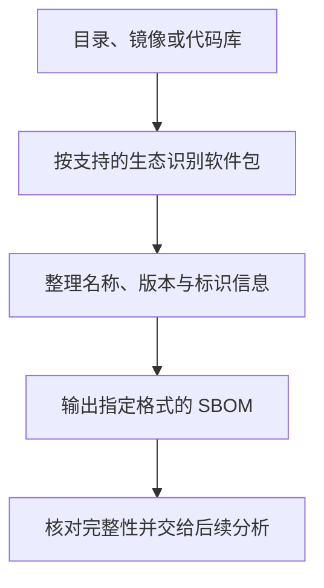

# Syft (Anchore): 软件物料清单生成

AI 应用的风险不只来自模型行为，也来自运行环境中的第三方软件。若依赖名称和版本不清楚，漏洞分析与许可核对就缺少可靠起点。**Syft 从目录、镜像等输入识别软件组件，生成软件物料清单（SBOM）。** 清单记录的是可识别组件的快照，完整性取决于扫描输入与检测能力。

<div class="article-meta" markdown="1">

**核实日期**：2026-10-08 · 参考: [GitHub](https://github.com/anchore/syft) | [官方文档](https://github.com/anchore/syft#readme) · 页面状态: `[可选工具/框架]` · 维护周期: 持续关注

</div>

## 软件组件识别与物料清单的形成

软件物料清单将包名、版本和可获得的标识信息整理成统一格式，便于交给后续分析工具。但依赖声明、镜像中的已安装包和实际运行环境是不同的输入。扫描源码目录与扫描部署镜像得到的组件可能不同，因此应先明确希望描述哪一个对象，再核对预期依赖是否出现。

例如代码库声明了四个 Python 包，实际镜像还可能包含系统库和其他已安装依赖。清单中的缺项需要排查输入与识别器，不能直接解释为组件不存在。漏洞匹配是后续工作；清单生成成功本身不会检查所有组件是否可利用，也不会验证模型权重或回答质量。

Syft 是命令行工具，输出可包含名称、版本、来源、许可证和组件标识等可获得信息。清单可作为 [Dependency-Track](dependency-track.md) 等后续分析工具的输入；许可证字段用于提示复核对象，不能独立作出许可判断。

### 从扫描对象到组件清单

<figure class="system-flow" markdown="1">



<figcaption>不同输入和检测器影响组件覆盖；清单生成与漏洞分析是不同环节。</figcaption>

</figure>

### 清单生成与后续分析的边界

<div class="tool-evidence-table" markdown="1">

| 能力边界 | 后续核验路径 |
|----------|----------|
| 漏洞检测 | 需要将 SBOM 导入 Dependency-Track 或其他漏洞管理平台进行持续分析 |
| 实际运行时加载情况 | 清单不能独立证明动态加载或运行时注入的依赖情况，需要运行时观察 |
| 自研代码分析 | Syft 识别已知包管理器管理的依赖，不分析自研代码中的安全问题 |
| SBOM 持续更新 | Syft 是快照生成工具，不提供持续监控，可集成到 CI/CD 实现定期生成 |

</div>

## 输入来源与清单输出的数据路径

本地进程或 CI 环境读取所指定的目录或镜像，形成 SPDX、CycloneDX 或 Syft JSON 等格式的清单。将输出交给漏洞分析平台后，数据路径进一步延伸到该平台及其外部资料源。输出格式不会改变扫描对象，格式兼容也不证明信息完整。

本地目录可在本机或 CI 环境处理，但远程镜像获取、更新检查及特定配置可能产生外部连接。因此应按实际输入来源、命令和网络配置确认数据去向，不能以软件安装在本地就推断全过程离线。

## 扫描目标与安装环境的要求

<div class="tool-evidence-table" markdown="1">

| 条件 | 说明 |
|------|------|
| 安装方式 | `curl -sSfL https://raw.githubusercontent.com/anchore/syft/main/install.sh \| sh` 或 `brew install syft` |
| Windows | 可通过 `scoop install syft` 或直接下载二进制文件 |
| 权限 | 读取目标文件系统或容器镜像的权限 |

</div>

## 为合成应用生成 CycloneDX 清单

以下输入、命令和字段片段均用于解释流程；本页未运行 Syft，不能视为已复现结果。实际复现时先固定版本并记录 `syft version`。截至 2026-10-08，官方 releases 将 v1.54.1 标为最新发布；本页命令语法据 Syft 1.54.0 生成的 CLI 文档核对，不能据此断言 v1.54.1 的参数完全相同。执行前用所选版本的 `syft --help` 确认。

> [教学示例] 以下所有示例均为**完全合成**数据（fully synthetic），针对的是虚构的 AI 应用代码库，不指向任何真实产品或服务。

```powershell
scoop install syft
```

### 安装后扫描合成目录

```powershell
syft scan dir:. -o cyclonedx-json=synthetic-ai-app-sbom.json
```

此处用 CLI 的 `-o 格式=文件路径` 写入文件，避免依赖 PowerShell 对原生命令重定向的编码行为。该语法见[官方 CLI 参考](https://oss.anchore.com/docs/reference/syft/cli/)；页面注明文档基于 Syft 1.54.0，运行前仍须用所选版本的 `syft --help` 确认。

针对一个包含 `requirements.txt` 的虚构 AI 应用目录：

```text
synthetic-ai-app/
├── app.py
├── requirements.txt
│   langchain==0.1.0
│   openai==1.12.0
│   chromadb==0.4.22
│   pydantic==2.5.0
└── Dockerfile
```

### 字段片段示意（非完整、不可导入的 BOM）

以下是**手工构造的字段示意，不是 Syft 的实际输出**。只列出来自合成输入的组件名与版本；没有列许可证，避免把未经核对的许可信息当作扫描结果。实际 BOM 的字段和版本依所用 Syft 及输出格式而定。

```json
{
  "bomFormat": "CycloneDX",
  "components": [
    {
      "type": "library",
      "name": "langchain",
      "version": "0.1.0",
      "purl": "pkg:pypi/langchain@0.1.0"
    },
    {
      "type": "library",
      "name": "openai",
      "version": "1.12.0",
      "purl": "pkg:pypi/openai@1.12.0"
    },
    {
      "type": "library",
      "name": "chromadb",
      "version": "0.4.22",
      "purl": "pkg:pypi/chromadb@0.4.22"
    },
    {
      "type": "library",
      "name": "pydantic",
      "version": "2.5.0",
      "purl": "pkg:pypi/pydantic@2.5.0"
    }
  ]
}
```

核对时先确认预期依赖是否出现在结果，再检查名称、版本和标识符；若缺项，先排查输入内容与该版本支持的 cataloger。不能仅凭这段手工片段声称实际目录已完整识别。

## 组件字段与部署证据的核对

### SBOM 关键字段

<div class="tool-evidence-table" markdown="1">

| 字段 | 含义 | 检查要点 |
|---|---|---|
| `name` | 已识别的组件名称 | 与输入及实际包名核对；广泛使用不等于可信 |
| `version` | 组件版本信息 | 字段可能缺失；有值也须确认是否对应实际部署版本 |
| `purl` / `cpe` | 组件标识符 | 可能用于漏洞匹配；是否存在及匹配质量取决于组件和输出数据 |
| `licenses` | 扫描到的许可证信息 | 缺项不代表没有许可义务；应回到包及许可证原文复核 |

</div>

### SBOM 中看不到的信息

<div class="tool-evidence-table" markdown="1">

| 清单不足以证明的事项 | 补充证据来源 |
|------------|-------------|
| 漏洞信息 | 需导入 Dependency-Track 或查询 NVD |
| 组件是否实际被调用 | 需要运行时分析或代码审查 |
| 实际组件调用路径 | 需要运行时观察或代码审查；静态依赖关系不能独立证明实际调用 |
| 模型权重的完整性与安全 | 软件包识别不等于模型权重核验，需独立检查模型来源及文件 |

</div>

### 从清单字段核验组件与版本

解读时先核对**扫描对象与实际部署是否一致**，再检查组件数量、类型及预期依赖。可获得的版本与标识符应与输入和部署证据互相核对；缺少字段不宜直接补成猜测值。

许可证需要回到组件原文复核，注意再分发、源代码提供或网络服务相关条件。GPL/AGPL 允许商业使用，不能等同于禁止商用。对于旧版本，应进一步查已知漏洞的适用条件；供应商声称的组件也应与实际清单比较，单看名称无法证明可信。

## 不同组件记录方式的适用范围

<div class="tool-evidence-table" markdown="1">

| 替代工具/方法 | 适用场景 | 覆盖损失 |
|--------------|---------|---------|
| 既有依赖声明或锁文件（如 `requirements.txt`、`package-lock.json`） | 简单 Python/JS 项目 | 不包含系统级依赖、缺少统一格式 |
| Trivy [可选工具/框架] | 兼具漏洞扫描功能 | SBOM 格式侧重不同 |
| CycloneDX Generator [可选工具/框架] | 需要特定的 CycloneDX 输出 | 包管理器覆盖范围不同 |

</div>

## 物料清单共享与许可边界

<div class="tool-evidence-table" markdown="1">

| 维度 | 内容 |
|------|------|
| **许可证** | [Apache 2.0](https://github.com/anchore/syft/blob/main/LICENSE) |
| **数据发送** | 本地目录可本地分析；镜像仓库拉取、更新检查或其他配置可能连接外部，按实际运行核实 |
| **SBOM 数据** | SBOM 本身不包含源码或业务数据，但包含内部项目名称和依赖关系 |
| **共享范围** | SBOM 可能暴露内部组件及依赖；使用合成或公开项目理解方法，分享前核对内容 |

</div>

## 官方入口

<div class="tool-evidence-table" markdown="1">

| 资源 | URL | 验证日期 |
|------|-----|---------|
| GitHub 仓库 | [https://github.com/anchore/syft](https://github.com/anchore/syft) | 2026-10-08 |
| 最新发布 | [v1.54.1](https://github.com/anchore/syft/releases/latest) | 2026-10-08 |
| 许可 | [项目 README](https://github.com/anchore/syft/blob/main/README.md) 标示 Apache-2.0；[LICENSE](https://github.com/anchore/syft/blob/main/LICENSE) | 2026-10-08 |
| 安装指南 | [https://github.com/anchore/syft#installation](https://github.com/anchore/syft#installation) | 2026-09-30 |
| CLI 参考 | [官方命令参考](https://oss.anchore.com/docs/reference/syft/cli/)（页面由 Syft 1.54.0 生成；非 v1.54.1 release 文档） | 2026-10-08 |
| Python cataloger 能力说明 | [Python catalogers](https://oss.anchore.com/docs/capabilities/python/)（当前在线文档列出 `requirements.txt` 声明依赖；实际覆盖取决于输入与 cataloger） | 2026-10-08 |
| Java cataloger 可选网络配置 | [UseNetwork 配置](https://github.com/anchore/syft/blob/main/syft/pkg/cataloger/java/config.go#L12-L14)（指向 `main` 分支，只作 Java cataloger 的特定配置示例） | 2026-10-08 |

</div>

---
