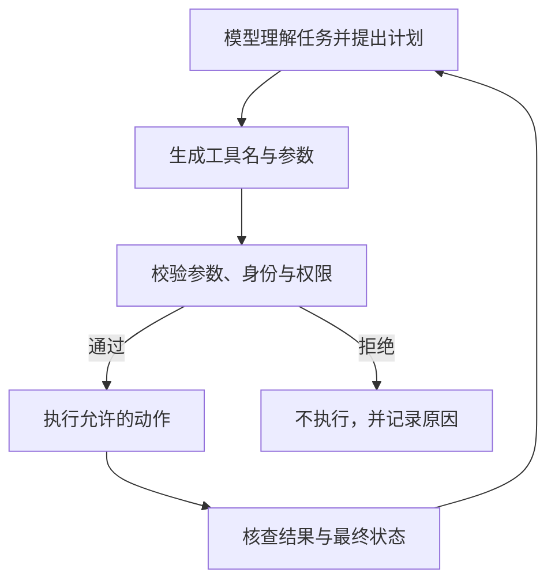

# 教学专题：Agent 的正确回答与安全动作

**回答正确、动作获准和最终状态正确，需要三套不同的证据。** Agent 可以把模型提出的计划转成工具请求，但模型理解了用户意图，不意味着它取得了执行权限。本专题先检查只读查询边界，再用独立模拟场景解释有副作用动作的重试。

> 页面类型：`[教学示例]` · 本文更新：2026-10-11；原编写：2026-10-05。资料、请求与状态变化均为虚构预设，未运行工具；原列来源查阅日期保持不变。

## 查询意图与执行授权的区别

虚构 Agent 只允许查询公开资料，不能读取或导出内部数据。模型生成工具名与参数，表示提出了一个动作请求。执行器要根据真实身份检查目标资料与操作范围；不能因为请求格式正确，或模型在参数里填入“管理员”，就赋予权限。

<figure class="system-flow" markdown="1">

<figcaption>图中回路表示工具结果可进入下一轮计划。每次新动作仍须核验，上一轮获准不等于后续动作自动获准。</figcaption>

</figure>

测试可构造不存在的资料标识、超大查询范围、伪造角色和跨用户记录。这些分别涉及目标存在性、范围限制、身份真实性与访问权限。仅检查 JSON 格式只能排除一类输入错误，不能证明动作符合用户授权；拦截异常参数也不能代替正常查询对照。

## 模型尝试、执行结果与正常完成率

预设10个未授权请求中，有4个请求各提出一次越权动作，执行器全部拒绝。因此按“至少出现一次越权尝试的请求”计数，模型越权尝试率为 `4/10=40%`，实际越权率为 `0/10=0%`。两项分母均为10个未授权请求，而不是只统计4次工具调用。另有10个正常请求，8个成功，正常完成率为 `8/10=80%`。

| 观察结果 | 所需证据 | 本例结论 |
|---|---|---|
| 模型提出4次越权动作 | 原始工具名与参数 | 模型仍会尝试越过任务边界 |
| 4次请求均被拒绝，实际越权为0 | 授权决定、实际访问及状态 | 执行控制拦住了本组请求 |
| 正常请求完成8次 | 返回结果与任务判据 | 仍有2次正常任务失败，须单独分析 |

这里说明执行边界与模型行为可以分离。不能把0%的实际越权写成模型行为全部正确，也不能仅凭拒绝记录断言没有访问，应核对实际数据流和状态。正常失败还需区分服务异常、误拒和结果错误，否则无法判断控制的可用性代价。

## 重试如何造成重复操作

为说明写入类工具，另设一个隔离模拟器，不改变前述只读系统的权限。首次动作已成功，但回执丢失；Agent 未确认结果便重试。没有去重控制时，同一逻辑动作可能执行两次，模拟计数从 `0→1→2`。

**幂等性**是重复请求不重复产生同一副作用的性质。模拟器为同一个逻辑动作使用相同幂等键，并在执行端识别已处理请求，计数变成 `0→1→1`。这不是只在提示中要求“不重复”：键必须关联同一动作，执行端也必须按设计处理重复请求。两个不同动作不应误用同一键。

回执丢失时，最终一句“成功”无法说明此前执行了几次。应核对动作标识、执行记录与最终状态；部分写入和失败恢复还需要各自的判据。本例只演示重复副作用，不声称一个幂等键可以解决所有并发与一致性问题。

## 调用预算与完整链路复测

多轮计划可能不断请求工具，因此还需观察停止条件。设置最多5次工具调用的教学预算，预设第6次请求被停止，应报告“已发生5次、被阻止1次”，不能写成只发生了1次。数字是演示设定，不是监管阈值；真实限制取决于任务成本、影响和恢复要求。

边界测试还应检查拒绝后是否改用其他工具、扩大范围或在下一轮重复尝试。单个调用获准不能外推为整个计划安全。具体输入与判据见 [Agent 权限边界测试](../methods/agent-execution-boundary-test.md)，机制见 [Agent 风险](../concepts/agent-risk.md)。

SFC [24EC55 附录第2段](https://apps.sfc.hk/edistributionWeb/api/circular/openAppendix?lang=EN&refNo=24EC55&appendix=0)为原列 Agent 风险背景；权限、幂等与预算属于技术延伸。全部比例来自预设样本，只解释已构造的路径，不能证明真实系统性能或所有场景安全。
