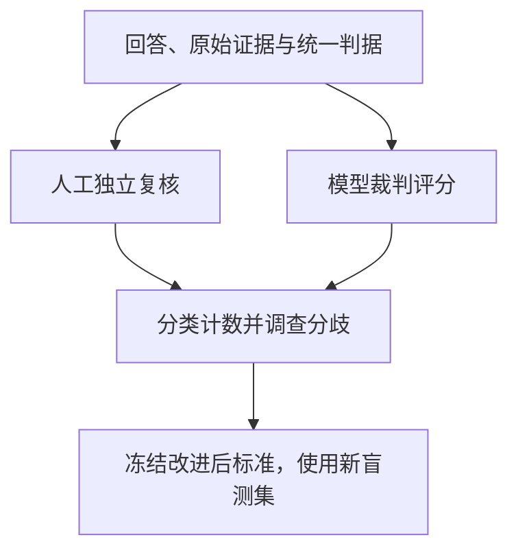

# 教学专题：80% 一致的裁判能否放心使用

自动评分可以缩短逐题核查时间，但裁判也会漏掉错误或误判正常回答。**总体一致率把两类问题合在一起，不能独立回答裁判是否适合当前用途。** 本专题用40条预设判定展示这种差异，并说明如何通过对照发现裁判偏好。

> 页面类型：`[教学示例]` · 本文更新：2026-10-11；原编写：2026-10-05。人工与裁判判定均为预设数据，无模型评分实测；原列来源查阅日期保持不变。

## 独立人工判据与模型评分的关系

先明确什么叫正确、错误和信息不足，再由人工按原始证据独立复核，形成参考标签。模型裁判使用相同的回答与证据评分，然后比较两条路径。人工不是天然无误：遇到规则含糊或证据冲突，应保留分歧与不确定原因，不能强行合并为一个确定标签。

<figure class="system-flow" markdown="1">

<figcaption>裁判与人工使用可比较的对象和标准；修订后应换用未参与调试的样本，避免记住校准集。</figcaption>

</figure>

本例40条回答中，人工判定10条失败、30条正常。裁判正确找出8条失败，漏掉2条；同时把6条正常误报为失败，正确接受24条正常。下表以“失败”为需要检出的事件，避免读者混淆正负类。

| 人工参考判定 | 裁判判为失败 | 裁判判为正常 | 合计 |
|---|---:|---:|---:|
| 失败 | 8 | 2 | 10 |
| 正常 | 6 | 24 | 30 |
| 合计 | 14 | 26 | 40 |

## 同一个80%，对应不同的错误代价

总体一致率为 `(8+24)/40=80%`。失败检出率为 `8/10=80%`，回答的是已有失败中找出了多少；报失败准确性为 `8/14≈57.1%`，回答的是裁判标出的失败中有多少确属失败。正常误报率为 `6/30=20%`，失败漏检率为 `2/10=20%`。

这些比例的分母不同，不能互换。若用途是筛查严重事实错误，2条漏检可能特别重要；若评分会自动阻止正常回答，6条误报又会损害可用性。需要逐例检查严重性、证据和判定理由，而不是设一个通用一致率便宣布可以放心使用。指标计算及校准步骤见 [模型裁判校准](../methods/judge-calibration.md)。

## 位置、长度与引用的对照

准备10对答案，将 A/B 位置交换而保持内容不变。预设3对裁判选择随位置反转，反转率为 `3/10=30%`。这个结果提示需要调查位置效应，但也可能包含评分随机性，应重复评分并检查理由，不能一次对照就断言原因。

另准备10对含义相同、长度不同的答案，预设长答案获胜8次。首先要人工确认长答案没有增加正确内容或重要限定；若两者质量确实不同，偏好长答案可能有合理依据。只有控制内容质量后，才适合研究长度是否影响评分。

引用测试应把“来源存在却不支持结论”与“来源根本不存在”分开。裁判若只奖励引用外观，就可能给两者高分；若没有访问原文，评分理由也不能代替真实引用核查。对这类失败应保存声明、对应原文及人工判断。

## 批量评分的实现与使用边界

批量运行需要冻结测试样本、裁判模型、提示、证据和输出格式，并把执行错误与判定失败分别保存。[Promptfoo](../tools/promptfoo.md)提供测试批次与断言等可选实现，人工表格也可复核本例。软件能保存评分，不意味着裁判已经校准；外部裁判还可能接收敏感上下文，应先核对数据流与脱敏。

修改标准后，用新的盲测集检查改善是否仍存在，并保留无法评分的样本及原因。不能直接删除难题后用更高分数证明改进。关键失败与不确定案例仍需独立证据，裁判得分只是评估证据之一。

SFC [24EC55 第13(c)段](https://apps.sfc.hk/edistributionWeb/api/circular/openFile?lang=EN&refNo=24EC55)为原列端到端测试背景，裁判实验是技术延伸，不是监管指定的评分方法或合格标准。
