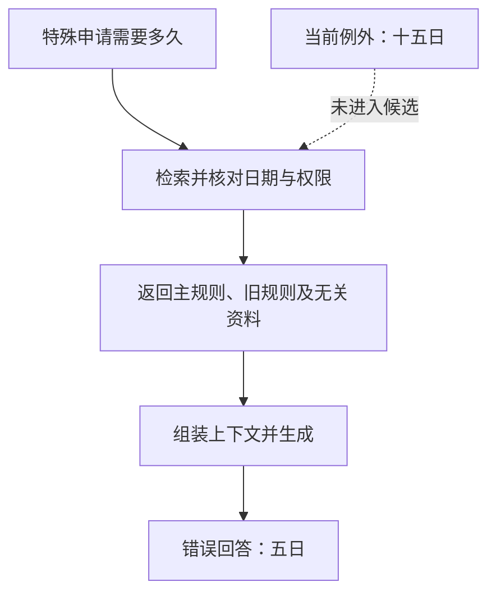

# 教学专题：找到资料为何仍会答错

**检索命中、证据有效、引用支持和答案完整，是四个需要分别核对的结果。** 本专题用一组申请时限规则，展示同一个“五日”答案如何来自不同环节，以及为什么一个检索分数不能解释整条链路。

> 页面类型：`[教学示例]` · 本文更新：2026-10-11；原编写：2026-10-05。资料、排名和回答均为合成数据与预设输出，未运行检索或生成工具。原列来源查阅日期保持不变。

## 一般规则与特殊申请的证据关系

虚构资料库有四份文件：D1 是旧规则，规定所有申请十日；D2 是当前主规则，规定普通申请五日；D3 是当前例外，规定特殊申请十五日；D4 是无关资料。当前用户获准读取四份教学资料，但只有 D2 与 D3 属于本题的当前相关集合。问题明确询问当前特殊申请需要多久，因此应回答十五日，并以当前例外支持结论。主规则用于理解规则结构，不能覆盖特殊申请。

若系统返回 D2、D1、D4，模型收到的是主规则、旧规则和无关材料，缺少决定本题的例外。回答“五日”虽然引用真实主规则，却把普通申请条件错误地用于特殊申请。这里首先暴露的是证据缺口；模型未承认信息不足，又构成回答层面的失败。

<figure class="system-flow" markdown="1">

<figcaption>图中是预设失败路径；缺少当前例外与未说明信息不足可以同时发生。</figcaption>

</figure>

## 检索计数与答案判定回答不同问题

本例把当前相关集合定义为 {D2,D3}，以不同文档为计数单位。前3位候选只命中 D2，因此召回率为 `Recall@3=1/2=50%`；3份返回文档中仅1份属于当前相关集合，精确率为 `Precision@3=1/3≈33.3%`。D1 的过时问题还应单独记录，不能让“不相关”标签掩盖版本风险。

这些分数描述检索集合，不是模型的答题分数。即使 D3 排在候选中，也需要检查它是否真正进入模型输入：排序、重复片段和长度截断都可能让候选证据在组装时丢失。实际上下文完整后，还要核对模型是否识别了特殊申请这一条件。

| 实际交给模型的证据 | 预设答案及引用 | 判读依据 |
|---|---|---|
| 缺少当前例外 | 五日，引用主规则 | 条件不适用，证据不足且回答错误 |
| 包含当前例外 | 五日，引用主规则 | 证据已送达，但未正确整合例外 |
| 包含当前例外 | 十五日，引用旧文件 | 数值正确，引用不支持当前结论 |
| 包含当前例外 | 十五日，引用当前例外 | 本题在所给证据与条件下通过 |

## 人工确认上下文的诊断对照

可将人工确认有效且获准使用的 D2 与 D3 直接交给生成环节，保持问题、模型和提示尽量一致。假设此时预设回答变成十五日，而正常链路仍回答五日，就增加了检索或上下文组装存在问题的证据；并不因此证明模型在其他题目上可靠。替换还可能改变资料顺序与长度，需注明这些变化。

若完整上下文仍回答五日，继续检查提示是否误设优先级、对话历史是否保留旧结论，以及模型是否遗漏适用条件。若仅给 D2，则本题不能得到充分支持，应检查系统是否说明无法确认，而不是把普通规则自动推广到特殊申请。详细对照见 [RAG 分层诊断](../methods/rag-design-diagnostics.md)。

同样要分别测试时间与身份变化。历史问题可能需要旧规则；权限不足的用户不能因为测试答案需要 D3 就获得读取权限。拒答只描述输出行为，不能补救已进入上下文的未授权资料。

## 评估与追踪的辅助实现

检索评估衡量必要资料是否找回，生成评估核对回答声明与完整性，调用链追踪关联候选、实际上下文和输出。应先确定这些证据，再选择软件。[Azure AI 评估器](../tools/azure-rag-evaluators.md)提供相关自动评估选项，[Phoenix](../tools/phoenix.md)辅助观察处理过程；自动判分需要人工校准，记录也不能自动证明答案正确。

SFC [24EC55 附录第9–10段](https://apps.sfc.hk/edistributionWeb/api/circular/openAppendix?lang=EN&refNo=24EC55&appendix=0)为原列关联来源；故事、计数口径与对照均为自行编写的教学内容。进一步理解机制可读 [RAG 概念](../concepts/rag.md)，指标定义分别见 [检索评估](../methods/rag-retrieval-evaluation.md)和 [生成评估](../methods/rag-generation-evaluation.md)。
